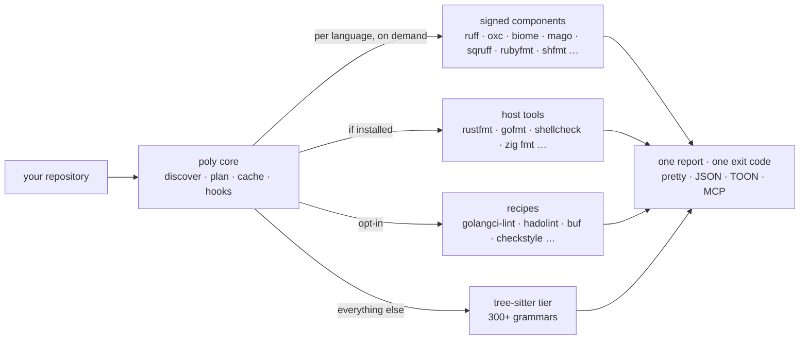

<!-- markdownlint-disable MD033 MD041 -->
<div align="center">


# polylint

**One linter and formatter for every language in your repository.**

polylint is a small binary, `poly`, driven by one `poly.toml`. It fetches the engine each language in your
repository needs — ruff, oxc, biome, mago, sqruff and more, as signed, checksum-verified components — uses the
canonical tools you already have (`rustfmt`, `gofmt`, `shellcheck`), and runs ecosystem linters such as
golangci-lint, hadolint, actionlint and buf as built-in recipes. Everything reports through one format, one exit
code and one cache.

40+ languages and file formats with a dedicated tool · tree-sitter formatting for 300+ more · git hooks and
commit linting · monorepo-aware config · MCP server and agent plugins

[](https://github.com/Goldziher/polylint/actions/workflows/ci.yaml)
[](LICENSE)
[](https://goldziher.github.io/polylint/)

[How it works](#how-it-works) · [Quick start](#quick-start) · [Languages](#languages) ·
[Why polylint](#why-polylint) · [Install](#installation) · [Docs](https://goldziher.github.io/polylint/)

</div>

---

## How it works



- **Components** — the engines (Rust crates, plus a Go sidecar for shell), signed and pinned to your poly version,
  downloaded once per language and cached. No Python, Node or Ruby runtime is needed for them. A needed component
  that cannot be installed is exit `2` (or a counted skip, if you ask for that), never a silent downgrade.
- **Host tools** — a language's canonical CLI when it is on `PATH`: `rustfmt`, `gofmt` and `shellcheck` on by
  default, `zig fmt`, `google-java-format`, `ktfmt`, `swift-format`, `dart format`, `gleam format` and `styler`
  opt-in. Absent, the language falls through to tree-sitter formatting with a notice.
- **Recipes** — ecosystem tools enabled with `[tools.<name>]`, run batched, with findings parsed per line. Most can
  download a checksummed release (`install = "auto"`); tools that need the JVM, Node or Python use the runtime
  already on your machine. polylint never bundles a runtime.
- **Tree-sitter tier** — best-effort formatting for languages with nothing better. Grammars are fetched on demand.
- **On every language** — a code-quality metrics engine and a 26-rule ast-grep pack, at warning severity.
- **Never silent** — a file nothing could check is counted and named; `--deny-skips` makes that a CI failure.

Files are discovered once (respecting `.gitignore`) and processed in parallel. The result cache is keyed by file
bytes, engine, engine version and resolved config, so an upgrade or a config change invalidates exactly what it
affects. `--debug` prints per-file engine timing and cache hits.

---

## Quick start

```sh
curl -fsSL https://raw.githubusercontent.com/Goldziher/poly/main/install.sh | sh
poly lint            # lint everything; the first run fetches the engines this repository needs
poly fmt --fix       # format everything
poly hooks install   # run both on every commit, without pre-commit or lefthook
```

The first `poly lint` downloads the components for the languages it finds (for a Python and TypeScript repository,
`python` and `web` among them), verifies each against the signed lock embedded in the binary, and caches it. Later
runs use the cache. The Linux musl build has every engine linked in and downloads nothing; see
[Installation](#installation).

```console
$ poly lint
./app.py
  warning  ruff  T201  5:5  `print` found
  warning  ruff  ANN201  4:5  Missing return type annotation for public function `main`
  error  ruff  F401  1:8  `os` imported but unused

3 issues found.
  2 files linted
  1 issue fixable with the `--fix` option
```

`poly fmt` without `--fix` is a dry run. Exit codes are a contract: `0` clean, `1` findings (or, for a `poly fmt`
dry run, files that would change), `2` the run verified less than it claims. `poly fmt --fix` exits `0` after
rewriting; add `--exit-nonzero-on-fix` for a CI step that must fail when the tree was not already formatted.

---

## Languages

**How it runs**: `component <name>` is a signed download (linked in on the bundled build); `host` is a CLI used
when installed; `recipe` is an opt-in `[tools.<name>]` integration (↓ = polylint can download a pinned release on
macOS and Linux; RT = needs a host runtime); `ts` is the tree-sitter tier. **Q** = quality-tier lint, **AG** =
built-in ast-grep rules.

<!-- markdownlint-disable MD013 -->

| Language or files | Lint | Format | How it runs |
|---|---|---|---|
| Python | ruff; ty or pyrefly (opt-in type check) · Q · AG | ruff | component `python` (`pyrefly`) |
| JavaScript, TypeScript, JSX, TSX | oxlint; skif (opt-in workspace check) · Q | oxc formatter | component `web` |
| JSON, JSONC | oxc parse errors | oxc formatter | component `web` |
| YAML | serde_yaml | oxc_formatter_yaml | component `web` |
| TOML | taplo | oxc_formatter_toml (taplo on request) | component `web` |
| Markdown, MDX | rumdl; adrlint (opt-in, ADRs) | oxc_formatter_markdown | component `web` |
| CSS, SCSS | biome | oxc_formatter_css (malva on request) | components `web`, `biome` |
| Less | — | oxc_formatter_css (malva on request) | component `web` |
| HTML, Vue, Svelte, Astro, Angular, XML, Jinja | — | markup_fmt | component `web` |
| GraphQL | graphql parse errors, biome | pretty_graphql | components `misc`, `biome` |
| SQL | sqruff | sqruff | component `sql` |
| PHP | mago | mago | component `php` |
| Ruby | Q · AG | rubyfmt | component `ruby` |
| Nix | — | alejandra | component `nix` |
| HCL, Terraform | hcl-edit; tflint (recipe ↓) | hclwrite port; tofu (recipe ↓), terraform (recipe) | component `misc` |
| Dockerfile | built-in rules; hadolint (recipe ↓) | — | component `misc` |
| `.env`, INI | dotenv, ini | — | component `misc` |
| Shell | shellcheck (host, default-on) | shfmt | component `sh` (Go sidecar) |
| Go | golangci-lint (recipe ↓) · Q · AG | gofmt (host, default-on); golangci-lint (recipe ↓) | host, recipe |
| Rust | cargo clippy, sort, machete, deny (whole-project phase) · Q · AG | rustfmt (host, default-on) | host |
| Java | checkstyle (recipe ↓, RT: JRE) · Q · AG | google-java-format (host, opt-in); palantir-java-format (recipe ↓, native) | host, recipe |
| Kotlin | Q · AG | ktfmt (host, opt-in) | host |
| Swift | AG | swift-format (host, opt-in) | host |
| Zig, Dart, Gleam, R | — | zig fmt, dart format, gleam format, styler (host, opt-in) | host |
| Groovy | npm-groovy-lint (recipe, RT: Node) | npm-groovy-lint | recipe |
| Protobuf | buf (recipe ↓) | buf | recipe |
| Starlark, Bazel | buildifier (recipe ↓) | buildifier | recipe |
| GitHub Actions workflows | actionlint (recipe ↓); gau (recipe) | — | recipe |
| Helm charts | helm, helm-template (recipe ↓) | — | recipe |
| `pyproject.toml` | — | pyproject-fmt (recipe, RT: Python) | recipe |
| C, C++, C# | Q (C# also AG) | tree-sitter | ts |
| Elixir | AG | tree-sitter | ts |
| 300+ other grammars | — | tree-sitter, best effort | ts |
| Any text | typos (opt-in) | — | component `typos` |
| Any language | uncomment (opt-in) | — | component `uncomment` |

<!-- markdownlint-enable MD013 -->

348 more tools from the embedded [mdsf](https://github.com/hougesen/mdsf) catalog can be enabled per tool, with
file-level verdicts. Recipe downloads are not available on Windows; install the tool yourself there. Full reference:
[Languages and engines](https://goldziher.github.io/polylint/reference/backends/) and
[Toolchains, runtimes and recipes](https://goldziher.github.io/polylint/guides/toolchains/).

---

## Why polylint

| If you use… | What changes |
|---|---|
| ruff, oxlint, biome, … individually | The same engines (ruff, oxc, biome and mago are linked as libraries), one config, one report format, one cache and one exit-code contract. No per-ecosystem toolchain for the built-in engines. |
| pre-commit or lefthook | `poly hooks` runs from `poly.toml`, checks a snapshot of the staged index rather than your worktree, and needs no Python environment. `poly migrate` converts `.pre-commit-config.yaml` and `lefthook.yml`. |
| MegaLinter or Super-Linter | No Docker image: a native binary fast enough for local runs and git hooks as well as CI, with a content-hash cache and per-line findings from parsed reports. Trade-off: they wrap more linters. |
| dprint | polylint lints as well as formats. |

---

## Demos

Real recordings — `vhs` runs each command live. Tapes are in [`docs/media/tapes/`](docs/media/tapes/).

**Kubernetes: 31,303 files in one run.**


**Django is not a Python repo** — it is Python, JavaScript, CSS, HTML, TOML, YAML and Markdown. One tool, one
config, one pass.


**Every report has a machine-readable form.** `--format toon` is compact enough to hand to an agent; `--format json`
is there when you want a document to parse.


**An agent can skip the terminal entirely.** `poly mcp` speaks MCP over stdio and advertises fourteen tools that
mirror the CLI.


---

## Installation

```sh
curl -fsSL https://raw.githubusercontent.com/Goldziher/poly/main/install.sh | sh   # macOS, Linux
brew install Goldziher/tap/poly
pnpm add --global @goldziher/polylint
pip install polylint
cargo binstall --git https://github.com/Goldziher/poly poly-cli
```

```powershell
irm https://raw.githubusercontent.com/Goldziher/poly/main/install.ps1 | iex
scoop bucket add goldziher https://github.com/Goldziher/scoop-bucket
scoop install poly
```

The installers verify the archive against `sha256sums.txt`; set `POLY_VERSION=0.34.0` to pin a release. Homebrew is
a rolling get-latest formula. The npm and PyPI packages are named `polylint` because `poly` is taken on both
registries; **the command is `poly` on every channel**, with `polylint` as an alias. Details:
[docs/INSTALL-PACKAGES.md](docs/INSTALL-PACKAGES.md).

### Platforms and builds

| Target | Build |
|---|---|
| Linux x86_64 (glibc), Linux aarch64 (glibc) | core |
| Linux x86_64 (musl) | **bundled** |
| macOS aarch64 (Apple silicon) | core |
| Windows x86_64 | core |

Intel macOS is not supported from the release after 0.34.0 (build from source); Windows arm64 and Linux musl
aarch64 have no release binary.

A **core** build is under 14 MiB (11.1 MB on macOS arm64) and downloads engine components on first use. The **bundled** build links every
engine and the MCP server in and downloads nothing. For controlled networks:

```sh
poly components sync .             # install what this directory needs, ahead of time
poly components import <archive>   # seed an air-gapped host
poly --offline lint .              # forbid every download (also POLY_OFFLINE=1)
```

`POLY_COMPONENT_MIRROR` points downloads at an internal mirror. See
[Components and offline use](https://goldziher.github.io/polylint/guides/components/).

### GitHub Actions

```yaml
- uses: actions/checkout@v4
- uses: Goldziher/poly@v0
  with:
    version: from-config # the release that `required_version` in poly.toml allows
    components: auto     # pre-install and cache the components this repository needs
- run: poly fmt .
- run: poly lint --deny-skips .
```

See [`ACTION_USAGE.md`](ACTION_USAGE.md) for every input.

---

## Configure

polylint works with no config. When you want one:

```toml
# poly.toml
[discovery]
exclude = ["vendor/**"]

[engines.ruff]
extend_select = ["D"]

[tools.golangci-lint]
enabled = true

[hooks]
stages = ["pre-commit", "commit-msg"]

[hooks.builtin]
lint = true
fmt = true
commit = { stages = ["commit-msg"] }
```

- `poly migrate` reads existing ruff, taplo, markdownlint and typos configs, `.pre-commit-config.yaml` and
  `lefthook.yml`, and folds what it can honor into `poly.toml` (dry run by default; `--write` applies).
- Nested `poly.toml` files cascade in a monorepo; `poly.local.toml` layers local overrides; `extends` shares a
  baseline across repositories; `poly config show` prints the effective result.
- Unknown keys, sections and wrongly typed values are reported as warnings, never silently ignored.

---

## Git hooks and commit linting

`poly hooks install` wires lint, format, file-safety and Conventional Commits checks into git from `[hooks]` in
`poly.toml`. Hooks run against a snapshot of the staged index, so unstaged edits neither hide nor cause failures.
`poly commit` lints and cleans commit messages. See
[Git hooks](https://goldziher.github.io/polylint/guides/hooks/).

---

## Agents and MCP

`poly mcp` is a stdio MCP server with fourteen tools that mirror the CLI (`lint`, `format_check`, `lint_fix`,
`format_write`, `components`, `workspace_lint`, …). Every result identifies the binary that answered and separates
checked, skipped and errored files, so an agent can gate on what was actually verified.

```text
/plugin marketplace add Goldziher/poly
/plugin install poly@poly
```

Any other MCP client runs it as `{ "command": "poly", "args": ["mcp"] }`. Plugins ship for Claude, Codex, Cursor,
Gemini, Kimi, OpenCode, Factory, Hermes, Pi, Agent Plugins and Copilot, and assume `poly` is already on `PATH`;
see [plugin/README.md](plugin/README.md) and
[Agents and MCP](https://goldziher.github.io/polylint/guides/agents-and-mcp/).

---

<details>
<summary><strong>What runs out of the box</strong></summary>

<!-- markdownlint-disable MD013 -->

| Engine | What it enables by default |
|---|---|
| **ruff** (Python) | 22 selector groups: ruff's own `F`, `E4`, `E7`, `E9`, plus `W6`, `I`, `UP`, `B`, `ANN`, `SIM`, `C4`, `RET`, `FURB`, `PERF`, `TRY`, `BLE`, `S110`, `C90`, `PLR`, `T20`, `TC`, `PTH`, `RUF`, `ARG`. `E1`/`E2`/`E3`/`W1`/`W2`/`W3` stay off because the formatter owns them, and seven noisy members are turned back off: `B008`, `RUF100`, `ANN002`, `ANN003`, `ARG002`, `PLR2004`, `TRY003`. Line length 120, docstring code formatted at width 120. |
| **oxlint** (JS/TS) | oxlint's own default is `correctness` only. poly adds `suspicious`, `pedantic`, `complexity`, `typescript/no-explicit-any`, `typescript/no-non-null-assertion` and `no-console`, all at warning. `restriction`, `style` and `nursery` stay off; `no-underscore-dangle`, `max-lines-per-function`, `max-lines` and `max-classes-per-file` are turned back off. |
| **mago** (PHP) | PHP 8.4, with six maintainability metrics downgraded from error to warning: `cyclomatic-complexity` (15), `excessive-parameter-list` (5), `too-many-methods` (10), `too-many-properties` (10), `too-many-enum-cases` (20), `kan-defect` (1). |
| **rumdl** (Markdown) | Five rumdl-proprietary stylistic rules disabled, plus four more for MDX. Line length 120. |
| **biome** (CSS/SCSS, GraphQL) | The `correctness` and `suspicious` rule groups. Accessibility, style, complexity, performance and security are opt-in. |

<!-- markdownlint-enable MD013 -->

Two cross-cutting lint tiers are on by default for every language, and two more are opt-in:

- **The code-quality engine** (on) — tree-sitter metric rules, listed below.
- **The built-in ast-grep pack** (on) — 26 rules across C#, Elixir, Go, Java, Kotlin, Python, Ruby, Rust and Swift.
  13 are on by default; the other 13 ship `severity: off` and are one config line away. Your own rules under
  `[engines.astgrep] rule_dirs` sit above the pack — a rule with the same `id` replaces the built-in one.
- **`typos`** (opt-in) — spell-checks identifiers, comments and strings: `[engines.typos] enabled = true`.
- **`uncomment`** (opt-in) — comment removal.

| Quality rule | Default |
|---|---|
| `file-too-long` | 1000 lines |
| `function-too-long` | 80 lines |
| `type-too-long` | 300 lines |
| `too-many-parameters` | 6 |
| `nesting-too-deep` | 4 |
| `cyclomatic-complexity` | 20 |
| `lazy-ignore` | on |
| `magic-number` | opt-in — allows −1, 0, 1, 2, 10, 100 |
| `law-of-demeter` | opt-in — chain depth 3 |
| `uncollected-test-file` | on for Python, Go, Ruby — a test name the runner will not collect |

The quality engine never duplicates an engine rule: where ruff or oxlint already covers a metric, it defers. It
counts as lint coverage only for languages whose control flow it can model — Python, Rust, Go, JavaScript, JSX,
TypeScript, TSX, Java, Kotlin, C, C++, C# and Ruby. Everything these tiers report is **warning** severity, and
warnings alone do not fail a run, so turning polylint on does not redden an unconfigured CI.

[adrlint](https://github.com/Goldziher/adrlint) is an opt-in MADR engine for numbered ADR files (`NNNN-*.md`),
enabled with `[engines.adrlint] enabled = true`; see
[ADR 0037](adrs/0037-adrlint-madr-linting.md) and [ADR 0041](adrs/0041-adrlint-tree-wide-rules-as-project-check.md).

</details>

---

## Performance

Release build, Apple Silicon, cold cache (`--no-cache`), best of three runs on an idle machine.
`poly lint --workspace never` and `poly fmt` over the whole repository, counting the files
poly actually inspected. These are poly's own numbers — **not** a comparison against ruff,
oxlint, biome or anything else; no such benchmark was run.

<!-- markdownlint-disable MD013 -->

| Project | `poly lint` | Findings | Peak RSS | `poly fmt` |
|---|---|---|---|---|
| Django | 3,113 files in **0.82s** | 66,839 | 0.21 GB | 5,539 files in 0.30s |
| home-assistant | 25,443 files in **3.5s** | 376,829 | 0.48 GB | 25,559 files in 1.2s |
| Kubernetes | 21,657 files in **6.8s** | 41,576 | 0.40 GB | 21,824 files in 12.9s |
| prettier | 7,057 files in **1.9s** | 19,373 | 0.40 GB | 7,450 files in 0.44s |
| TypeScript | 32,606 files in **13.3s** | 179,586 | 0.52 GB | 40,012 files in 4.0s |

<!-- markdownlint-enable MD013 -->

Kubernetes is the one repository where formatting costs more than linting: its Go files go
through the host `gofmt`, one subprocess per file, and ~20,000 process spawns dominate the run.

Repeat runs are faster — Django re-lints in 0.71s warm against 0.82s cold: a cache hit skips the
engine entirely, and everything else is split across cores.

---

## Documentation

- [Quickstart](https://goldziher.github.io/polylint/start/quickstart/) — install, first run, first config.
- [Adopting polylint in a polyglot repo](https://goldziher.github.io/polylint/guides/adopting/) — migration,
  rollout, CI.
- [Configuration](https://goldziher.github.io/polylint/guides/configuration/) — every key, rule selection, inline
  suppression, monorepo cascading, shared and remote config.
- [Toolchains, runtimes and recipes](https://goldziher.github.io/polylint/guides/toolchains/) — host tools, recipe
  downloads, host runtimes, reproducibility.
- [Components and offline use](https://goldziher.github.io/polylint/guides/components/) — bundled and core builds,
  `[components]`, mirrors, air-gapped hosts.
- [Git hooks](https://goldziher.github.io/polylint/guides/hooks/) — `poly hooks install`, builtin hooks, staged
  isolation, timeouts, concurrency, caching.
- [Migrating to the v2 config schema](https://goldziher.github.io/polylint/guides/migrating-to-v2/) — the
  `poly.toml` v2 schema and the removed CLI flags.
- [CLI reference](https://goldziher.github.io/polylint/reference/cli/) — every subcommand and flag, and the
  exit-code contract.

---

## Contributing

Keep changes small and test-backed. A new or changed engine needs known-bad and known-unformatted fixtures under
`crates/poly-core/tests/`, and must preserve the uniform `Engine` boundary. Before committing:

```sh
poly hooks install   # wires lint/format/cargo checks into git; they run on every commit
cargo test --workspace --no-fail-fast
```

For anything touching the runner, an engine, or the rule pack, also run the hardening harness. poly's
own fixtures are small and chosen to exercise a known path; the harness runs poly over real
third-party trees and checks the things fixtures cannot — that no file errored, that formatting
converges in two passes, that the cache never serves a different answer than a cold run, and that no
language poly claims to lint reports `no lint rules for` it:

```sh
mise run harden           # pinned third-party repositories
mise run harden:local     # the sibling working trees next door, read-only
mise run harden:generated # machine-generated code (corpus C)
```

It also reports per-rule finding counts per repository, which is how a pack rule earns a default
severity. See [`docs/harden-corpus.md`](docs/harden-corpus.md) for what each corpus is allowed to
assert, and why a count needs a pinned input while an invariant does not.

For anything touching an engine component, run the component dev loop. `components:dev` builds the
named components (`sql` when none is named) in debug, packages them unsigned and writes a `file://`
lock under `target/components/`. `components:parity` then tests `poly-core` with `engine-sql` off and
the `dev-lock` feature on, so sql can only come from the component: the lint and format output must
match the in-process snapshots byte for byte, and a component whose hash differs from its lock must
fail the run:

```sh
mise run components:dev      # build sql (or: mise run components:dev web ruby) and write the dev lock
mise run components:parity   # components-mode tests; fails, never skips, if the lock is missing
```

`dev-lock` makes poly read the lock named by `POLY_COMPONENT_DEV_LOCK`. It is for development only,
and the release workflow fails a binary that was built with it.

---

## License

MIT - see [LICENSE](LICENSE).
