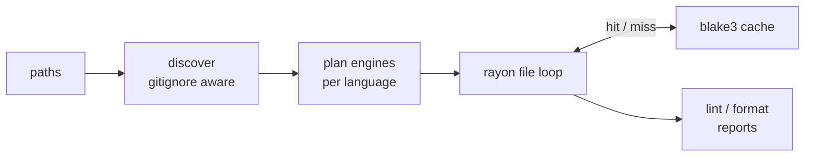

import { Aside, CardGrid, Card, LinkCard, Steps } from '@astrojs/starlight/components';

polylint is one linter and formatter for every language in a repository: a small binary, `poly`,
and one `poly.toml`. It exists because the alternative — ruff for Python, oxlint for TypeScript,
`rustfmt` for Rust, `gofmt` for Go, prettier for CSS, a YAML linter, a TOML formatter, and a hook
framework to orchestrate them — means a toolchain per ecosystem, a config file per tool, and a
different report format from each.

polylint runs those tools as **engines** behind one config, one report format and one exit-code
contract. The built-in engines need no Node, Python or Ruby runtime: they ship as signed
**components** that the binary downloads the first time a run needs them, verified against a lock
embedded in the binary. Where a language's canonical tool is a CLI (`rustfmt`, `gofmt`), polylint
runs the one you have installed. Terms used throughout the docs are defined in the
[glossary](/poly/reference/glossary/).

## How a file gets checked

Every file resolves through the same ladder. Nothing here is a fallback you should avoid — the
lower rungs are the coverage mechanism, and a language can be promoted upward later without any
change to how you invoke poly.

<Steps>

1. **Engines from components.** The highest-fidelity path: ruff for Python, oxc for
   JavaScript/TypeScript/JSON (and oxfmt's own formatter crates for YAML, TOML, Markdown and CSS),
   taplo and rumdl for TOML and Markdown lint, sqruff for SQL, mago for PHP, `markup_fmt` for
   HTML/Vue/Svelte, shfmt for shell (a Go sidecar), and more. Linked into the bundled Linux musl
   build, or downloaded as signed components by every other build (see
   [Components and offline use](/poly/guides/components/)).

2. **Host tools.** For languages whose canonical formatter is a CLI with no usable Rust library.
   `rustfmt`, `gofmt` and `shellcheck` run as subprocesses automatically when present on `PATH`;
   `zig fmt`, `google-java-format`, `ktfmt`, `swift-format`, `dart format`, `gleam format` and
   `styler` are opt-in. When the tool is absent the language falls through to the tree-sitter
   tier with a notice.

3. **Tree-sitter tier.** The catch-all for everything else — Elixir, C, C++, protobuf, and the
   long tail of 300+ grammars, fetched on demand. Best-effort structural reindent, **formatting
   only**: it establishes no lint coverage.

4. **Recipes and catalog tools.** Any of 348 tools from the embedded catalog, opt-in per tool with
   `[tools.<name>] enabled = true`, probed on `PATH` and giving a file-level verdict. Fifteen of
   them — `golangci-lint`, `helm`, `buf`, `hadolint`, `tflint`, `actionlint`, `checkstyle`, … —
   carry a **recipe** that runs them batched, parses their reports into per-line findings, and for
   most can download a checksummed release. See
   [Toolchains, runtimes and recipes](/poly/guides/toolchains/).

</Steps>

On top of all four, two **cross-cutting** lint tiers run on every language, both on by default at
*warning* severity so adopting polylint never reddens an unconfigured CI:

- The native **code-quality engine** — file and function length, parameter count, nesting depth,
  cyclomatic complexity, lazy ignore markers, and test files the test runner will not collect. It defers to a tier-1 backend wherever one
  already reports the same measurement, so no metric is reported twice.
- The built-in **ast-grep rule pack** — 26 rules across C#, Elixir, Go, Java, Kotlin, Python,
  Ruby, Rust and Swift, embedded in the binary and loaded through the same parser as your own
  custom rules.

<Aside type="tip" title="Missing is never silent">
    Every engine polylint runs is pinned to its version and verified. A needed component that
    cannot be installed is an error (exit `2`) or, with `[components] on_missing = "skip"`, a
    counted skip — never a quiet fallback to a different formatter. Host tools and catalog tools
    raise fidelity where they are installed; their absence lowers fidelity with a notice. For a
    machine with no network, use the bundled Linux musl build or `poly components import`.
</Aside>

## How a run works

poly discovers files once, installs any component the run needs, plans engines once per language,
then runs the per-file work in parallel on a rayon pool.



Every backend returns the same diagnostic and format-output shapes, so reporting, caching and MCP
output stay uniform no matter which tool produced a finding.

The result cache is keyed by the file's bytes, the engine name, the engine version and the
resolved engine config — so a tool upgrade or a config change invalidates exactly the entries it
affects and nothing else. It lives in the per-user OS cache directory, never in the repository.

## Coverage is accounted for, not assumed

A linter that silently checks nothing is worse than one that fails. poly counts every file it
declined and says why:

```console
$ poly lint --verbose .
skipped main.zig: no lint rules for Zig
```

Skips have several sources: a language nothing in the run lints, no matching engine, a file poly
deliberately withholds a write from, a binary file, or an engine the caller withdrew with
`--only`/`--skip` or `enabled = false`. All of them appear in the summary and the `--format json`
payload, but only the ones naming a limit of poly count against `--deny-skips` / `--max-skips` — a
caller instruction never does, since it already says so in its own name (see
[Coverage and withdrawal](/poly/guides/configuration/#coverage-and-withdrawal)). A run that verified
less than it claims exits **2**, distinct from the **1** that means real findings.

<Aside type="caution" title="`poly lint` is not read-only by default">
    After the per-file tier, `poly lint` runs a **whole-project phase** that executes the configured
    whole-workspace tools (`cargo clippy`, `cargo sort`, `cargo machete`, `cargo deny`, any
    configured type checker) against the live worktree. poly writes nothing without `--fix`, but
    those tools have their own side effects — `cargo clippy` populates `target/` and can refresh
    `Cargo.lock`. Pass `--workspace never`, or set `[workspace] run = "never"`, for a run that must
    leave the tree untouched.
</Aside>

## Where to go next

<CardGrid>
    <LinkCard title="Installation" href="/poly/start/installation/" description="Every channel, and what each one actually installs." />
    <LinkCard title="Quickstart" href="/poly/start/quickstart/" description="First lint, first format, first hook install." />
    <LinkCard title="Why polylint" href="/poly/start/why-polylint/" description="How it compares with the tools you may use now." />
    <LinkCard title="Languages and engines" href="/poly/reference/backends/" description="The language-by-language table." />
    <LinkCard title="Configuration" href="/poly/guides/configuration/" description="Everything poly.toml can say." />
</CardGrid>
